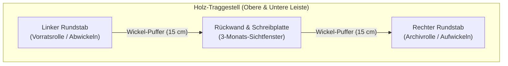

# CronoScroll — Scroll Calendar 📜

> **Ein interaktiver Generator für endlose Rollkalender mit 3-Monats-Schreibplatte für Großformat-Plotter.**

---

## 💡 Das Konzept

Klassische Kalender blättert man monatsweise um. **CronoScroll** basiert auf dem Prinzip antiker Schriftrollen (*Volumina*):
Der Kalender wird als **ein einziges, zusammenhängendes Banner** (über 2 Meter lang) auf Endlospapier gedruckt und in einen Wand- oder Tischrahmen aus Holz eingespannt.

### Der physische Rahmenaufbau:
* **Zwei horizontale Holzleisten (oben & unten):** Bilden das tragende Gerüst. Sie halten links und rechts die Lagerungen der Rundstäbe und fixieren mittig die Rückwand.
* **Zwei vertikale Rundstäbe (Walzen):** Sind drehbar in der oberen und unteren Holzleiste gelagert und dienen zum Auf- und Abwickeln des Papierbanners.
* **Feste Rückwand / Schreibplatte:** Ist stabil an den beiden horizontalen Holzleisten montiert und bietet eine plane Unterlage zum handschriftlichen Eintragen von Notizen.
* **3-Monats-Sichtfenster:** Die Schreibplatte ist so dimensioniert, dass immer exakt **drei Monate gleichzeitig** im Blickfeld liegen (z. B. Vormonat, aktueller Monat und Folgemonat).
* **14-Monate-Zyklus:** Das Banner umfasst 14 Monate (Dezember des Vorjahres $\to$ alle 12 Monate des Zieljahres $\to$ Januar des Folgejahres). Dadurch rollt man nahtlos über den Jahreswechsel.

---

## 📐 Grafische Darstellung des fertigen Kalenders

### Konstruktions- & Rahmenplan

```text
 ╔══════════════════════════════════════════════════════════════════════════════════════════════════════╗
 ║                         OBERE HORIZONTALE HOLZLEISTE (Tragrahmen)                                    ║
 ║     [ Lager links ] ═══════════════[ Verschraubung Rückwand ]═══════════════ [ Lager rechts ]       ║
 ╚══════════╦══════════════════════════════════════════════════════════════════════════╦════════════════╝
            ║                                                                           ║
      ┌─────╨─────┐                     ┌──────────────────────────────────┐      ┌─────╨─────┐
      │  Linker   │ ◄── Wickel-Puffer ─►│   RÜCKWAND / SCHREIBPLATTE       │◄────►│  Rechter  │
      │  Rundstab │     (z.B. 15 cm)    │   (fest an Querleisten montiert) │      │  Rundstab │
      │           │                     │                                  │      │           │
      │    (O)    │═════════════════════│  ┌────────────────────────────┐  │══════│    (O)    │
      │     ║     │  Papierbahn gleitet │  │  MONAT 1  │ MONAT 2│ MONAT 3│ │  │      │     ║     │
      │     ║     │  über die Platte ─► │  ├───────────┼────────┼────────┤ │  │      │     ║     │
      │     ║     │                     │  │ 01 Sa     │ 01 Di  │ 01 Fr  │ │  │      │     ║     │
      │     ║     │                     │  │ 02 So [WE]│ 02 Mi  │ 02 Sa  │ │  │      │     ║     │
      │     ║     │                     │  │ ...       │ ...    │ ...    │ │  │      │     ║     │
      │     ║     │                     │  │ 31 Mo     │ [Leer] │ 31 So  │ │  │      │     ║     │
      │     ║     │                     │  └────────────────────────────┘  │      │     ║     │
      │    (O)    │                     │                                  │      │    (O)    │
      │           │                     │◄─────── Breite: B_visible ──────►│      │           │
      │(Abwickeln)│                     │          (z.B. 42,0 cm)          │      │(Aufwickeln│
      └─────╥─────┘                     └──────────────────────────────────┘      └─────╥─────┘
            ║                                            ▲                              ║
            ║                                            │ Höhe: H_visible              ║
            ║                                            │ (z.B. 32,0 cm)               ║
            ║                                            ▼                              ║
 ╔══════════╩══════════════════════════════════════════════════════════════════════════╩════════════════╗
 ║     [ Lager links ] ═══════════════[ Verschraubung Rückwand ]═══════════════ [ Lager rechts ]       ║
 ║                         UNTERE HORIZONTALE HOLZLEISTE (Tragrahmen)                                   ║
 ╚══════════════════════════════════════════════════════════════════════════════════════════════════════╝
```

### Explosions- / Baugruppenansicht (Seitenprofil)

```text
       Rückseite (Wand)
             │
             ▼
      ┌─────────────┐  ◄── Obere Querleiste
      │  [Lager] ───┼──────────────┐
      │     │       │              │
      │     ▼       │              │
      │  (Rundstab) │         [Rückwand / Schreibplatte]
      │     │       │              │
      │     ▼       │              │  ◄── Papierbahn läuft auf der Vorderseite
      │  [Lager] ───┼──────────────┘
      └─────────────┘  ◄── Untere Querleiste
             ▲
             │
       Vorderseite
```

### Papierfluss & Funktionsdiagramm



---

## 🧮 Das Mathematische Modell

Alle Abmessungen leiten sich dynamisch von der montierten Schreibplatte ab:

| Parameter                       | Symbol               | Formel / Erklärung                                                                                                                  | Standardwert                            |
| :------------------------------ | :------------------- | :---------------------------------------------------------------------------------------------------------------------------------- | :-------------------------------------- |
| **Plattenbreite (Sichtbreite)** | $B_{\text{visible}}$ | Lichte Weite der 3 sichtbaren Monate                                                                                                | $42{,}0\text{ cm}$                      |
| **Monatsspalten-Breite**        | $B_{\text{month}}$   | $B_{\text{month}} = \frac{B_{\text{visible}}}{3}$                                                                                   | $14{,}00\text{ cm}$                     |
| **Sichtfensterhöhe**            | $H_{\text{visible}}$ | Papierbahnbreite (Zeilenraum)                                                                                                       | $30{,}0\text{ cm}$                      |
| **Tagesfeld-Höhe**              | $H_{\text{day}}$     | Einspaltig: $\frac{H_{\text{visible}}}{32}$; zweispaltig: $\frac{H_{\text{visible}}}{17}$ *(1 Kopfzeile + 16 Tageszeilen je Liste)* | $0{,}94\text{ cm}$ / $1{,}76\text{ cm}$ |
| **Wickel-Puffer**               | $\text{Puffer}$      | Freiraum für Befestigung an den Rundstäben                                                                                          | je $15{,}0\text{ cm}$                   |
| **Gesamte Bannerlänge**         | $L_{\text{total}}$   | $L_{\text{total}} = (14 \times B_{\text{month}}) + (2 \times \text{Puffer})$                                                        | $226{,}00\text{ cm}$                    |

> [!TIP]
> **Zwei Monatslayouts:** Im klassischen Layout steht jeder Tag in einer Zeile. Alternativ verteilen sich die Tage **1–15 links** und **16–31 rechts**; ein Tagesfeld wird dann bei 30 cm Sichthöhe etwa **1,76 cm hoch**. Beide Layouts verwenden dieselbe Monatsbreite von 14 cm, Sichthöhe von 30 cm und Bannerlänge.

---

## 🚀 Features der Webanwendung (`index.html`)

* **Light und Dark Mode:** Die Oberfläche folgt zunächst der Systemeinstellung. Der Sonne/Mond-Schalter speichert eine manuelle Auswahl im Browser; Kalenderfarben, Vorschau und CAD-Zeichnung bleiben davon unabhängig.
* **Zwei interaktive Ansichts-Modi:**
  * 🖼️ **3-Monats-Schreibplatte (Fokus-Ansicht):** Zeigt exakt die 3 Monate, wie sie auf der echten Holzplatte liegen. Mit den Buttons `[Zurück]` / `[Vor]` oder den **Pfeiltasten (`←` / `→`)** rollt man nahtlos Monat für Monat durch das Jahr.
  * 📜 **Ganze Druckrolle (14 Monate):** Zeigt das gesamte $2{,}26\text{ m}$ Banner für die Druckkontrolle mit Klick-zu-Monat-Navigation und echtem „Fit All“-Zoom.
* **Kalender- und CAD-Arbeitsmodus:** Der Modus-Umschalter wechselt zwischen Kalender-Editor und 2D-CAD-Konstruktion. Sichtfenster und Papierbahnlänge werden zentral vom Kalender in Millimeter übergeben; Presets können diese Synchronisierung nach Bestätigung vorübergehend überschreiben. Im CAD vergrößern einstellbare Zuschläge die Rückwand gegenüber dem Sichtfenster (Standard: 4 mm breiter und 2 mm höher); das Papiermaß bleibt unverändert. Das CAD-Modul zeigt eine dynamische Stückliste und unterstützt A4-Querformat-SVG- sowie Vektor-PDF-Export. Direktlinks können den Startmodus (`?mode=cad` oder `?mode=calendar`) und im Kalender den Einstellungs-Tab (`?mode=calendar&tab=geometry`, `layout`, `style`, `holidays` oder `presets`) festlegen; sie lassen sich mit einem `?config=`-Link kombinieren. Beim Wechsel von Modus oder Tab wird der aktuelle Zustand mit `history.replaceState` in der URL aktualisiert, wobei andere Parameter und das Fragment erhalten bleiben; der Tab bleibt auch beim Wechsel zu CAD gespeichert.
* **Interaktive HTML5 Canvas Live-Vorschau:**
  * Reagiert in Echtzeit auf jede Parameteränderung.
  * Stufenloser Zoom von 20 % bis 300 % und 100%-Reset.
  * Wahlweise eine oder zwei Tageslisten pro Monat; im zweispaltigen Layout bleiben Sichtfenster und Baugröße unverändert.
  * Optionaler Trennstreifen zwischen Monaten, für beide Tageslistenlayouts getrennt einstellbar: 0,1–20 mm breit, mit frei wählbarer Farbe und Deckkraft, wahlweise bis in die Monatskopfzeile. Der Streifen verkleinert die Tagesfelder, nicht aber Sichtfenster oder Rollenlänge; er erscheint auch in PDF, SVG und PNG.
* **Erscheinungsbild:**
  * **Darstellung** und **Farben** sind getrennte, tastaturbedienbare Auswahlen: Die Darstellung legt Struktur und Zeichenformen fest; Farben setzen Palette und Schrift. Beide Auswahlen sind unabhängig kombinierbar.
  * Wochenend-, Feiertags-, Ferien- und eigene Terminfarben sind nach Aufgabe gruppiert. Eine Änderung der Kategorie-Farbe aktualisiert alle vorhandenen Einträge dieser Kategorie; einzelne Terminfarben lassen sich in der Terminverwaltung weiterhin bearbeiten.
  * Wählbare, in der PDF eingebettete Schriftarten (*Lato*, *PT Serif*, *Cousine*) und skalierbare Schriftgrößen für Kopf- und Tageszeilen.
  * Eigene TTF-Schriften können lokal geladen werden. Die gewählte Schrift erscheint in der Vorschau und wird in die Plotter-PDF eingebettet.
  * Einstellbare Linienstärken für Gitter und Umrandungen in Millimetern.
  * Farbwähler mit direkt bearbeitbarem Hexwert: deckende Farben verwenden `#RRGGBB`, transparente Farben `#RRGGBBAA`. Ein separater Transparenzregler wird nicht angezeigt; Transparenz bleibt über den achtstelligen Hexwert bearbeitbar und wird in Vorschau und Export berücksichtigt. Tages- und Ereignisfarben beginnen mit 11 % Deckkraft. Die PDF mischt transparente Farben für den Druck mit der Papierfarbe.
  * Fünf Kalenderdarstellungen: **Mid-Century**, **Bauhaus**, **Gantt**, **Zen** und **Kursbuch** (zusätzlich „Klassisch“). Sie sind im Tab „Erscheinung“ wählbar, werden lokal gespeichert und in Vorschau, PNG, PDF und SVG dargestellt. Die Zeichnung verwendet dieselben 14 Monatsspalten und Tagespositionen wie das klassische Design, auch bei zwei Tageslisten.
  * Darstellung und Farben sind unabhängig kombinierbar. Die Farbwelten setzen eine bearbeitbare Farbpalette und Schriftfamilie, die auch für alle fünf Spezialdesigns und Exporte gilt. Ohne gewählte Farbwelt behalten Spezialdesigns ihre bisherigen stilabhängigen Schrift-Defaults. Termine erscheinen als Text, Kalenderwochen und Mondphasen gemäß den zugehörigen Schaltern. Schnittmarken und Monatstrennstreifen bleiben optional.
  * Zen nutzt den vorhandenen Monatskopf als Weißraum statt eines zusätzlichen 30-mm-Abstands. Gantt zeichnet Wochenmarken aufgrund der Leserichtung horizontal und Themen-Spalten vertikal. Kursbuch zählt die Tage jedes Kalenderjahres einschließlich des 366. Tages im Schaltjahr; die Übergangsmonate verwenden ihr eigenes Jahr.
* **Deutsche Feiertage & Schulferien (nach Bundesland):**
  * Automatische Berechnung aller gesetzlichen Feiertage über die Gaußsche Osterformel für alle 16 Bundesländer (**Standard: Nordrhein-Westfalen / NRW**).
  * Berücksichtigt auch die Feiertage der Übergangsmonate (Dezember des Vorjahres und Januar des Folgejahres).
  * Vordefinierte Schulferien werden erst nach Aktivierung erzeugt. Eigene und importierte Termine bleiben beim Neuberechnen erhalten.
  * Individuelle Zeiträume (Urlaube, Geburtstage, Meilensteine) frei hinzufügbar und editierbar.
* **Vorlagen und Teilen:**
  * Vorlagen werden unter dem Kalendernamen lokal im Browser (`localStorage`) gespeichert. Ältere Vorlagen werden einmalig auf 30 × 42 cm und deaktivierte Ferien umgestellt; eigene Termine bleiben erhalten. Später gespeicherte Maße bleiben unverändert.
  * Teilbare Links öffnen die Gestaltungseinstellungen für das aktuelle oder das folgende Jahr. Individuelle und importierte Termine werden nicht übertragen; Feiertage und, falls aktiviert, Ferien werden für das gewählte Jahr und die Region neu berechnet. Eigene Schriftdateien müssen erneut geladen werden.
  * Der optionale QR-Code erscheint in der Druckrollen-Vorschau und im Kalenderexport. Sein Abstand zum letzten Monat beträgt standardmäßig 40 mm; bei zu kleinem rechtem Nachlauf wird ein Hinweis angezeigt.
* **RGB-Plotter-PDF für Endlosplotter:**
  * Generiert über **jsPDF** eine millimetergenaue Vektor-PDF mit dem Kalendernamen als Dateinamen, exakt einer Seite, eingebetteten TrueType-Schnitten (normal, fett, kursiv), deutschen Monatsnamen (`Januar` bis `Dezember`), deutschen Tageskürzeln (`Mo` bis `So`) und Randbeschriftungen.
  * Im rechten Montagepuffer steht ein vektorieller QR-Code mit demselben Folgejahres-Link wie im Tab „Vorlagen & Teilen“. Die Rollenmaße ändern sich nicht; bei zu schmalem Puffer, unvollständigem Inhalt, nicht verfügbarem Schriftschnitt oder nicht platzierbarem Titel meldet der Export einen Fehler statt eine unvollständige Datei zu speichern.
  * Die Datei enthält sachliche Basis-Metadaten und bleibt ein RGB-Plotterexport ohne PDF/X-, ICC-, CMYK- oder Sonderfarbenzusage. Die Drucksoftware beziehungsweise der Druckdienstleister führt die Ausgabe-Farbkonvertierung aus.
* **Druckflächen-Schätzung und Spartipps:** Die Statusleiste zeigt für die gesamte 14-Monats-Rolle den geschätzten mittleren Schwarzauftrag (K) und den summierten Farbauftrag (C+M+Y). Im Tab „Erscheinung“ lassen sich passende Änderungsvorschläge vergleichen und einzeln anwenden, zum Beispiel Papier- oder Wochenendhintergründe auf Weiß/Papierfarbe setzen oder Terminfarben entsättigen. Die Werte werden aus einer verkleinerten RGB-Renderung abgeleitet, nicht aus einer druckerspezifischen CMYK-Separation; sie sind daher weder eine Verbrauchs- noch eine Preiszusage. Der summierte Farbwert kann bis zu 300 % betragen.

---

## 🛠️ Empfehlungen für den Eigenbau

1. **Horizontale Holzleisten (oben & unten):**
   * Querschnitt z. B. $20 \times 40\text{ mm}$ oder $25 \times 50\text{ mm}$ (z. B. Eiche, Buche oder Nussbaum).
   * Erhalten an beiden Enden Sacklöcher bzw. Bohrungen (oder kleine Kugellager/Messingbuchsen) zur Aufnahme der Stabenden.
2. **Vertikale Rundstäbe:**
   * Rundstäbe (Durchmesser $20\text{ bis }25\text{ mm}$). An den Enden ggf. abgedreht oder mit Holzdübeln als Drehachse versehen. Ein oberer Drehknauf oder Rändelrad erleichtert das Weitertransportieren.
3. **Rückwand / Schreibplatte:**
   * Eine $4\text{ bis }6\text{ mm}$ starke Platte (z. B. HDF, Multiplex oder Acrylglas), die oben und unten fest in einer Nut sitzt oder von hinten an die Querleisten verschraubt ist.
   * Die seitlichen Kanten sollten leicht gerundet geschliffen werden, damit das Papier beim Transport nicht kratzt.
4. **Papiersorte:**
   * **$90\text{ bis }120\text{ g/m²}$ gestrichenes CAD-/Plotterpapier (matt)**:
   * Schlägt beim Beschreiben nicht durch.
   * Bleibt auch aufgerollt flexibel und baut nicht zu dick auf den Walzen auf.

---
 
## 💻 Verwendung

Keine Installation und kein Node.js erforderlich. Du kannst die Anwendung lokal durch Öffnen von [index.html](./index.html) in einem modernen Webbrowser (Chrome, Firefox, Safari, Edge) verwenden oder sie über GitHub Pages aufrufen.

Die Versionsangabe in der unteren Statusleiste wird in `index.html` manuell gepflegt; Git-Commits erhöhen sie nicht automatisch. Bei einer Versionsänderung auch den Titel und die Überschrift in `index.html` entsprechend anpassen.

Maße deiner Schreibplatte eintragen, Design anpassen und auf **„Plotter-PDF exportieren“** klicken. Die fertige PDF-Datei kannst du an einen Rollenplotter oder Druckdienstleister senden.

Für die Konstruktion den Modus **„CAD-Konstruktion“** wählen. Die Kalendermaße bleiben dort standardmäßig synchronisiert und schreibgeschützt; nach einer bestätigten Preset-Übernahme lassen sie sich über **„Mit Kalender verknüpfen“** wieder synchronisieren. CAD-SVG und -PDF sind im A4-Querformat angelegt. Auch beim direkten Öffnen per `file://` ist kein lokaler Webserver erforderlich.

Für eine eigene Schrift im Bereich **Erscheinung → Typografie** eine TTF-Datei auswählen. Sie wird nur im Browser verarbeitet und nicht hochgeladen; eine einzelne TTF-Datei wird für normale, fette und kursive Textstellen verwendet. Eigene Schriften müssen nach einem Neuladen erneut ausgewählt werden. Die mitgelieferten Schriften Lato, PT Serif und Cousine stehen unter der SIL Open Font License 1.1; die Lizenztexte liegen in [`fonts/`](./fonts/).

Der QR-Code wird lokal mit [qrcode-generator](https://github.com/kazuhikoarase/qrcode-generator) ([MIT-Lizenz](./js/qrcode.LICENSE.txt), Copyright Kazuhiko Arase) erzeugt; die Konfiguration wird nicht an einen QR-Dienst gesendet. Der Folgejahres-Link öffnet die öffentliche Anwendung und überträgt keine individuellen oder importierten Termine. Ein zum Kalenderjahr passender Jahresbestandteil im individuellen Titel wird auf das Folgejahr gesetzt. Die Jahresauswahl reicht bis 2100; für 2100 ist deshalb kein Folgejahres-Link verfügbar.

Die eingebetteten PT-Serif-Dateien stammen aus der Google-Fonts-Auslieferung (Version 19: [normal](https://fonts.gstatic.com/s/ptserif/v19/EJRVQgYoZZY2vCFuvDFR.ttf), [fett](https://fonts.gstatic.com/s/ptserif/v19/EJRSQgYoZZY2vCFuvAnt65qV.ttf), [kursiv](https://fonts.gstatic.com/s/ptserif/v19/EJRTQgYoZZY2vCFuvAFTzro.ttf)). Sie enthalten GPOS-Kerning ohne die zu große ältere `kern`-Tabelle. Bei eigenen TTF-Dateien weist CronoScroll auf erkennbar übergroße Kerning-Untertabellen hin; die Datei wird nicht verändert und andere Font-Probleme lassen sich nicht vollständig vorab erkennen.


