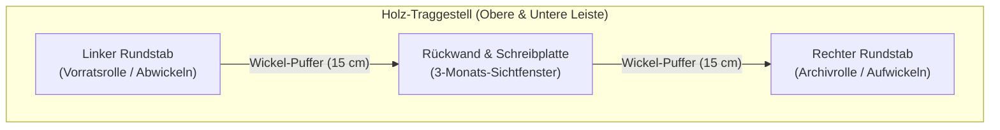

# CronoScroll — Scroll Calendar 📜

> **Ein interaktiver Generator für endlose Rollkalender mit 3-Monats-Schreibplatte für Großformat-Plotter.**

---

## 💡 Das Konzept

Klassische Kalender blättert man monatsweise um. **CronoScroll** basiert auf dem Prinzip antiker Schriftrollen (*Volumina*):
Der Kalender wird als **ein einziges, zusammenhängendes Banner** (über 2 Meter lang) auf Endlospapier gedruckt und in einen Wand- oder Tischrahmen aus Holz eingespannt.

### Der physische Rahmenaufbau:
* **Zwei horizontale Holzleisten (oben & unten):** Bilden das tragende Gerüst. Sie halten links und rechts die Lagerungen der Rundstäbe und fixieren mittig die Rückwand.
* **Zwei vertikale Rundstäbe (Walzen):** Sind drehbar in der oberen und unteren Holzleiste gelagert und dienen zum Auf- und Abwickeln des Papierbanners.
* **Feste Rückwand / Schreibplatte:** Ist stabil an den beiden horizontalen Holzleisten montiert und bietet eine plane Unterlage zum handschriftlichen Eintragen von Notizen.
* **3-Monats-Sichtfenster:** Die Schreibplatte ist so dimensioniert, dass immer exakt **drei Monate gleichzeitig** im Blickfeld liegen (z. B. Vormonat, aktueller Monat und Folgemonat).
* **14-Monate-Zyklus:** Das Banner umfasst 14 Monate (Dezember des Vorjahres $\to$ alle 12 Monate des Zieljahres $\to$ Januar des Folgejahres). Dadurch rollt man nahtlos über den Jahreswechsel.

---

## 📐 Grafische Darstellung des fertigen Kalenders

### Konstruktions- & Rahmenplan

```text
 ╔══════════════════════════════════════════════════════════════════════════════════════════════════════╗
 ║                         OBERE HORIZONTALE HOLZLEISTE (Tragrahmen)                                    ║
 ║     [ Lager links ] ═══════════════[ Verschraubung Rückwand ]═══════════════ [ Lager rechts ]       ║
 ╚══════════╦══════════════════════════════════════════════════════════════════════════╦════════════════╝
            ║                                                                           ║
      ┌─────╨─────┐                     ┌──────────────────────────────────┐      ┌─────╨─────┐
      │  Linker   │ ◄── Wickel-Puffer ─►│   RÜCKWAND / SCHREIBPLATTE       │◄────►│  Rechter  │
      │  Rundstab │     (z.B. 15 cm)    │   (fest an Querleisten montiert) │      │  Rundstab │
      │           │                     │                                  │      │           │
      │    (O)    │═════════════════════│  ┌────────────────────────────┐  │══════│    (O)    │
      │     ║     │  Papierbahn gleitet │  │  MONAT 1  │ MONAT 2│ MONAT 3│ │  │      │     ║     │
      │     ║     │  über die Platte ─► │  ├───────────┼────────┼────────┤ │  │      │     ║     │
      │     ║     │                     │  │ 01 Sa     │ 01 Di  │ 01 Fr  │ │  │      │     ║     │
      │     ║     │                     │  │ 02 So [WE]│ 02 Mi  │ 02 Sa  │ │  │      │     ║     │
      │     ║     │                     │  │ ...       │ ...    │ ...    │ │  │      │     ║     │
      │     ║     │                     │  │ 31 Mo     │ [Leer] │ 31 So  │ │  │      │     ║     │
      │     ║     │                     │  └────────────────────────────┘  │      │     ║     │
      │    (O)    │                     │                                  │      │    (O)    │
      │           │                     │◄─────── Breite: B_visible ──────►│      │           │
      │(Abwickeln)│                     │          (z.B. 42,0 cm)          │      │(Aufwickeln│
      └─────╥─────┘                     └──────────────────────────────────┘      └─────╥─────┘
            ║                                            ▲                              ║
            ║                                            │ Höhe: H_visible              ║
            ║                                            │ (z.B. 32,0 cm)               ║
            ║                                            ▼                              ║
 ╔══════════╩══════════════════════════════════════════════════════════════════════════╩════════════════╗
 ║     [ Lager links ] ═══════════════[ Verschraubung Rückwand ]═══════════════ [ Lager rechts ]       ║
 ║                         UNTERE HORIZONTALE HOLZLEISTE (Tragrahmen)                                   ║
 ╚══════════════════════════════════════════════════════════════════════════════════════════════════════╝
```

### Explosions- / Baugruppenansicht (Seitenprofil)

```text
       Rückseite (Wand)
             │
             ▼
      ┌─────────────┐  ◄── Obere Querleiste
      │  [Lager] ───┼──────────────┐
      │     │       │              │
      │     ▼       │              │
      │  (Rundstab) │         [Rückwand / Schreibplatte]
      │     │       │              │
      │     ▼       │              │  ◄── Papierbahn läuft auf der Vorderseite
      │  [Lager] ───┼──────────────┘
      └─────────────┘  ◄── Untere Querleiste
             ▲
             │
       Vorderseite
```

### Papierfluss & Funktionsdiagramm



---

## 🧮 Das Mathematische Modell

Alle Abmessungen leiten sich dynamisch von der montierten Schreibplatte ab:

| Parameter                       | Symbol               | Formel / Erklärung                                                                                                                  | Standardwert                            |
| :------------------------------ | :------------------- | :---------------------------------------------------------------------------------------------------------------------------------- | :-------------------------------------- |
| **Plattenbreite (Sichtbreite)** | $B_{\text{visible}}$ | Lichte Weite der 3 sichtbaren Monate                                                                                                | $42{,}0\text{ cm}$                      |
| **Monatsspalten-Breite**        | $B_{\text{month}}$   | $B_{\text{month}} = \frac{B_{\text{visible}}}{3}$                                                                                   | $14{,}00\text{ cm}$                     |
| **Sichtfensterhöhe**            | $H_{\text{visible}}$ | Papierbahnbreite (Zeilenraum)                                                                                                       | $30{,}0\text{ cm}$                      |
| **Tagesfeld-Höhe**              | $H_{\text{day}}$     | Einspaltig: $\frac{H_{\text{visible}}}{32}$; zweispaltig: $\frac{H_{\text{visible}}}{17}$ *(1 Kopfzeile + 16 Tageszeilen je Liste)* | $0{,}94\text{ cm}$ / $1{,}76\text{ cm}$ |
| **Wickel-Puffer**               | $\text{Puffer}$      | Freiraum für Befestigung an den Rundstäben                                                                                          | je $15{,}0\text{ cm}$                   |
| **Gesamte Bannerlänge**         | $L_{\text{total}}$   | $L_{\text{total}} = (14 \times B_{\text{month}}) + (2 \times \text{Puffer})$                                                        | $226{,}00\text{ cm}$                    |

> [!TIP]
> **Zwei Monatslayouts:** Im klassischen Layout steht jeder Tag in einer Zeile. Alternativ verteilen sich die Tage **1–15 links** und **16–31 rechts**; ein Tagesfeld wird dann bei 30 cm Sichthöhe etwa **1,76 cm hoch**. Beide Layouts verwenden dieselbe Monatsbreite von 14 cm, Sichthöhe von 30 cm und Bannerlänge.

---

## 🚀 Features der Webanwendung (`index.html`)

* **Light und Dark Mode:** Die Oberfläche folgt zunächst der Systemeinstellung. Der Sonne/Mond-Schalter speichert eine manuelle Auswahl im Browser; Kalenderfarben, Vorschau und CAD-Zeichnung bleiben davon unabhängig.
* **Zwei interaktive Ansichts-Modi:**
  * 🖼️ **3-Monats-Schreibplatte (Fokus-Ansicht):** Zeigt exakt die 3 Monate, wie sie auf der echten Holzplatte liegen. Mit den Buttons `[Zurück]` / `[Vor]` oder den **Pfeiltasten (`←` / `→`)** rollt man nahtlos Monat für Monat durch das Jahr.
  * 📜 **Ganze Druckrolle (14 Monate):** Zeigt das gesamte $2{,}26\text{ m}$ Banner für die Druckkontrolle mit Klick-zu-Monat-Navigation und echtem „Fit All“-Zoom.
* **Kalender- und CAD-Arbeitsmodus:** Der Modus-Umschalter wechselt zwischen Kalender-Editor und 2D-CAD-Konstruktion. Sichtfenster und Papierbahnlänge werden zentral vom Kalender in Millimeter übergeben; Presets können diese Synchronisierung nach Bestätigung vorübergehend überschreiben. Im CAD vergrößern einstellbare Zuschläge die Rückwand gegenüber dem Sichtfenster (Standard: 4 mm breiter und 2 mm höher); das Papiermaß bleibt unverändert. Das CAD-Modul zeigt eine dynamische Stückliste und unterstützt A4-Querformat-SVG- sowie Vektor-PDF-Export. Direktlinks können den Startmodus (`?mode=cad` oder `?mode=calendar`) und im Kalender den Einstellungs-Tab (`?mode=calendar&tab=geometry`, `layout`, `style`, `holidays` oder `presets`) festlegen; sie lassen sich mit einem `?config=`-Link kombinieren. Beim Wechsel von Modus oder Tab wird der aktuelle Zustand mit `history.replaceState` in der URL aktualisiert, wobei andere Parameter und das Fragment erhalten bleiben; der Tab bleibt auch beim Wechsel zu CAD gespeichert.
* **Interaktive HTML5 Canvas Live-Vorschau:**
  * Reagiert in Echtzeit auf jede Parameteränderung.
  * Stufenloser Zoom von 20 % bis 300 % und 100%-Reset.
  * Wahlweise eine oder zwei Tageslisten pro Monat; im zweispaltigen Layout bleiben Sichtfenster und Baugröße unverändert.
  * Optionaler Trennstreifen zwischen Monaten, für beide Tageslistenlayouts getrennt einstellbar: 0,1–20 mm breit, mit frei wählbarer Farbe und Deckkraft, wahlweise bis in die Monatskopfzeile. Der Streifen verkleinert die Tagesfelder, nicht aber Sichtfenster oder Rollenlänge; er erscheint auch in PDF, SVG und PNG.
* **Erscheinungsbild:**
  * **Darstellung** und **Farben** sind getrennte, tastaturbedienbare Auswahlen: Die Darstellung legt Struktur und Zeichenformen fest; Farben setzen Palette und Schrift. Beide Auswahlen sind unabhängig kombinierbar.
  * Wochenend-, Feiertags-, Ferien- und eigene Terminfarben sind nach Aufgabe gruppiert. Eine Änderung der Kategorie-Farbe aktualisiert alle vorhandenen Einträge dieser Kategorie; einzelne Terminfarben lassen sich in der Terminverwaltung weiterhin bearbeiten.
  * Wählbare, in der PDF eingebettete Schriftarten (*Lato*, *PT Serif*, *Cousine*) und skalierbare Schriftgrößen für Kopf- und Tageszeilen.
  * Eigene TTF-Schriften können lokal geladen werden. Die gewählte Schrift erscheint in der Vorschau und wird in die Plotter-PDF eingebettet.
  * Einstellbare Linienstärken für Gitter und Umrandungen in Millimetern.
  * Farbwähler mit direkt bearbeitbarem Hexwert: deckende Farben verwenden `#RRGGBB`, transparente Farben `#RRGGBBAA`. Ein separater Transparenzregler wird nicht angezeigt; Transparenz bleibt über den achtstelligen Hexwert bearbeitbar und wird in Vorschau und Export berücksichtigt. Tages- und Ereignisfarben beginnen mit 11 % Deckkraft. Die PDF mischt transparente Farben für den Druck mit der Papierfarbe.
  * Fünf Kalenderdarstellungen: **Mid-Century**, **Bauhaus**, **Gantt**, **Zen** und **Kursbuch** (zusätzlich „Klassisch“). Sie sind im Tab „Erscheinung“ wählbar, werden lokal gespeichert und in Vorschau, PNG, PDF und SVG dargestellt. Die Zeichnung verwendet dieselben 14 Monatsspalten und Tagespositionen wie das klassische Design, auch bei zwei Tageslisten.
  * Darstellung und Farben sind unabhängig kombinierbar. Die Farbwelten setzen eine bearbeitbare Farbpalette und Schriftfamilie, die auch für alle fünf Spezialdesigns und Exporte gilt. Ohne gewählte Farbwelt behalten Spezialdesigns ihre bisherigen stilabhängigen Schrift-Defaults. Termine erscheinen als Text, Kalenderwochen und Mondphasen gemäß den zugehörigen Schaltern. Schnittmarken und Monatstrennstreifen bleiben optional.
  * Zen nutzt den vorhandenen Monatskopf als Weißraum statt eines zusätzlichen 30-mm-Abstands. Gantt zeichnet Wochenmarken aufgrund der Leserichtung horizontal und Themen-Spalten vertikal. Kursbuch zählt die Tage jedes Kalenderjahres einschließlich des 366. Tages im Schaltjahr; die Übergangsmonate verwenden ihr eigenes Jahr.
* **Deutsche Feiertage & Schulferien (nach Bundesland):**
  * Automatische Berechnung aller gesetzlichen Feiertage über die Gaußsche Osterformel für alle 16 Bundesländer (**Standard: Nordrhein-Westfalen / NRW**).
  * Berücksichtigt auch die Feiertage der Übergangsmonate (Dezember des Vorjahres und Januar des Folgejahres).
  * Vordefinierte Schulferien werden erst nach Aktivierung erzeugt. Eigene und importierte Termine bleiben beim Neuberechnen erhalten.
  * Individuelle Zeiträume (Urlaube, Geburtstage, Meilensteine) frei hinzufügbar und editierbar.
* **Vorlagen und Teilen:**
  * Integrierte Vorlagen stehen getrennt von lokal gespeicherten Vorlagen zur Verfügung. Sie sind schreibgeschützt; nach dem Laden können Änderungen als lokale Vorlage gespeichert werden.
  * Vorlagen werden unter dem Kalendernamen lokal im Browser (`localStorage`) gespeichert. Ältere Vorlagen werden einmalig auf 30 × 42 cm und deaktivierte Ferien umgestellt; eigene Termine bleiben erhalten. Später gespeicherte Maße bleiben unverändert.
  * Teilbare Links öffnen die Gestaltungseinstellungen für das aktuelle oder das folgende Jahr. Individuelle und importierte Termine werden nicht übertragen; Feiertage und, falls aktiviert, Ferien werden für das gewählte Jahr und die Region neu berechnet. Eigene Schriftdateien müssen erneut geladen werden.
  * Der optionale QR-Code erscheint in der Druckrollen-Vorschau und im Kalenderexport. Sein Abstand zum letzten Monat beträgt standardmäßig 40 mm; bei zu kleinem rechtem Nachlauf wird ein Hinweis angezeigt.

### Datenmodell für Darstellung, Farbwelten und Teilen

Die Anwendung hält die Kalenderoptionen in einem zentralen Zustandsobjekt. `designStyle` wählt die Zeichenstruktur (`classic`, `midcentury`, `bauhaus`, `gantt`, `zen` oder `kursbuch`); `themeKey` wählt optional eine Farbwelt. Die Farbwelt setzt zunächst die Palette und Schriftfamilie, die anschließend bearbeitbar sind. Darstellung und Farbwelt sind voneinander unabhängig. Ohne ausgewählte Farbwelt können die Spezialdarstellungen ihre eigenen Schrift-Defaults verwenden.

**Integrierte Vorlagen:** JSON-Dateien in `presets/` enthalten jeweils ein Objekt mit Vorlagennamen als Schlüsseln und Zustandsobjekten als Werten, wie im folgenden Beispiel. Nach dem Hinzufügen oder Ändern von Dateien `npm run presets:generate` ausführen und den erzeugten Katalog `js/builtInPresets.js` mit veröffentlichen. Der Katalog funktioniert auch beim direkten Öffnen per `file://`; neue Dateien werden erst durch erneute Generierung aufgenommen. Die Prüfung verlangt `_calendarPresetVersion: 1` und gültige vollständige Kalender-Einstellungen einschließlich Land, Region und beider Monatstrennstreifen. Optionale Ansichtsfelder und Termine werden ebenfalls geprüft; `holidays` darf fehlen, damit Feiertage beim Laden neu berechnet werden. Ungültige Dateien und Einträge werden mit Dateiname, Vorlagenname und betroffenen Feldern gemeldet und übersprungen; gültige Einträge bleiben im Katalog. Bei doppelten Namen gewinnt der erste gültige Eintrag in alphabetischer Dateireihenfolge, der spätere wird gemeldet. Bei Fehlern liefert der Befehl Exit-Code 1, schreibt aber trotzdem den Katalog der gültigen Einträge.

**Lokale Vorlagen** sind davon getrennt: Unter `cronoscroll_v2_presets` liegt in `localStorage` ein JSON-Objekt, dessen Schlüssel die Vorlagennamen und dessen Werte gespeicherte Zustandsobjekte einschließlich der Version `_calendarPresetVersion: 1` sind. Beim Speichern wird der Vorlagenname auch als Kalendername übernommen. Die Einträge sind an den lokalen Browser und dessen Speicher gebunden; es gibt keine Importfunktion in der Oberfläche. Ein extern erstellter JSON-Eintrag muss daher manuell mit den vorhandenen Einträgen in `localStorage` zusammengeführt werden. Ältere Einträge ohne aktuelle Vorlagenversion werden beim Laden einmalig auf 30 × 42 cm und deaktivierte Ferien umgestellt. Dabei werden Ferien-Einträge aus dem gespeicherten Terminbestand entfernt, andere Termine bleiben erhalten. Eine eigene Schriftdatei ist nicht Teil des Zustands und muss nach dem Laden erneut ausgewählt werden.

Für eine neue lokale Vorlage sollte der Wert ein vollständiges Zustandsobjekt verwenden. Der folgende JSON-Schnappschuss enthält alle aktuell gespeicherten Zustandsfelder und die Standardwerte aus der Anwendung; `holidays: []` bedeutet hier absichtlich, dass keine Termine gespeichert sind:

```json
{
  "Frühlingsplan 2027": {
    "_calendarPresetVersion": 1,
    "year": 2027,
    "hVisible": 30,
    "bVisible": 42,
    "backpanelOffsetHeightMm": 2,
    "backpanelOffsetWidthMm": 4,
    "pufferLeft": 15,
    "pufferRight": 15,
    "pufferLeftContent": "blank",
    "pufferRightContent": "blank",
    "bannerCustomTitle": "Frühlingsplan 2027",
    "qrEnabled": true,
    "qrGapMm": 40,
    "showVacations": false,
    "monthLayout": "single",
    "designStyle": "classic",
    "themeKey": null,
    "monthSeparators": {
      "single": {
        "enabled": false,
        "widthMm": 0.5,
        "colorMode": "custom",
        "color": "#cbd5e1",
        "header": false
      },
      "double": {
        "enabled": false,
        "widthMm": 0.5,
        "colorMode": "custom",
        "color": "#cbd5e1",
        "header": false
      }
    },
    "subColumns": 1,
    "guideLinesCount": 0,
    "guideLinesStyle": "dashed",
    "showKW": true,
    "showMoon": true,
    "showCropMarks": false,
    "headerStyle": "uppercase",
    "headerAlign": "center",
    "monthHeaderTextColor": "#0f172a",
    "monthHeaderTextSize": 1,
    "calendarWeekTextColor": "#64748b",
    "calendarWeekTextSize": 1,
    "moonOpacity": 0.89,
    "fontFamily": "sans",
    "fontHeaderScale": 1,
    "fontDayScale": 1,
    "lineGrid": 0.2,
    "lineBorder": 0.6,
    "paperColor": "#ffffff",
    "colorHeaderBg": "#f1f5f9",
    "colorHeaderText": "#0f172a",
    "colorGrid": "#cbd5e1",
    "colorText": "#0f172a",
    "colorSaturdayBg": "#64748b1c",
    "colorSaturdayText": "#0f172a",
    "colorSundayBg": "#e11d481c",
    "colorSundayText": "#e11d48",
    "colorWeekendBg": "#f1f5f9",
    "colorWeekendText": "#e11d48",
    "categoryColors": {
      "public": "#d977061c",
      "vacation": "#0284c71c",
      "custom": "#16a34a1c"
    },
    "country": "DE",
    "bundesland": "NW",
    "holidays": [],
    "holidayFilter": "all",
    "holidaySearchQuery": "",
    "viewMode": "plate",
    "currentMonthIndex": 1,
    "zoom": 1,
    "isDraggingViewport": false,
    "dragStartX": 0,
    "isPanning": false,
    "panStartX": 0,
    "panStartY": 0,
    "scrollStartX": 0,
    "scrollStartY": 0
  }
}
```

Wichtige Regeln für diesen Snapshot:

* `year`, Titel, Maße, Gestaltung, Farben, Land und Region sollten zusammenpassen. Für Geometrie, Aufbau, Farben und Darstellungen gelten die oben dokumentierten Feldtypen und Wertebereiche; zusätzlich sind `holidayFilter` (`all`, `public`, `vacation` oder `custom`) und `viewMode` (`plate` oder `banner`) zulässige Werte.
* `monthSeparators` braucht beide Einträge (`single` und `double`) mit jeweils `enabled`, `widthMm`, `colorMode`, `color` und `header`. Fehlende Trennstreifenwerte werden beim Laden zwar mit Standardwerten ergänzt, ein vollständig erzeugter Snapshot sollte sie dennoch enthalten.
* Die Vorlagen-Ladefunktion validiert das Objekt nicht vollständig. Insbesondere gelten die strengen Share-Link-Validierungen nicht automatisch für lokale Vorlagen; Werte daher genau im dokumentierten Format halten. `_calendarPresetVersion: 1` muss gesetzt sein, sonst behandelt der Loader den Eintrag als ältere Vorlage und migriert ihn.
* `holidays` ist eine vollständige Terminliste des Schnappschusses. Ist es ein Array – auch ein leeres –, wird es beim Laden nicht automatisch durch Feiertage ersetzt; bei `showVacations: false` werden lediglich Ferien-Einträge herausgefiltert. Soll die Anwendung Feiertage und gegebenenfalls Ferien beim Laden passend zu Jahr und Region neu erzeugen, die Eigenschaft `holidays` ganz weglassen. Eigene Termine werden dann nicht mitgespeichert. Sollen eigene Termine zusammen mit Feiertagen oder Ferien enthalten sein, muss `holidays` stattdessen die vollständige gewünschte Liste enthalten; diese wird als Snapshot geladen und nicht neu berechnet.
* Ein Terminobjekt hat die Form `{"id":"termin_fruehling_1","title":"Frühlingsbeginn","start":"2027-03-20","end":"2027-03-20","color":"#16a34a","type":"custom"}`. `id` sollte innerhalb der Liste eindeutig sein; `start` und `end` sind gültige Kalenderdaten im Format `YYYY-MM-DD`, `end` darf nicht vor `start` liegen, und bei eintägigen Terminen sind beide gleich. `type` ist für eigene oder importierte Termine `custom`; automatisch berechnete Kategorien heißen `public` und `vacation`. Farben verwenden `#RRGGBB` oder `#RRGGBBAA`.
* Zum lokalen Anwenden den Vorlagenwert unter dem gewünschten Namen in das existierende JSON-Objekt `cronoscroll_v2_presets` einfügen und dieses Objekt wieder als JSON in `localStorage` speichern. Bestehende Einträge dabei zusammenführen, nicht überschreiben. Das Objekt ist nur für dieselbe Browser-Origin und denselben Browser verfügbar.

Wenn das erzeugte JSON-Objekt beispielsweise in `generatedPresets` liegt, kann es in der Browser-Konsole der geöffneten CronoScroll-Seite mit den vorhandenen Einträgen zusammengeführt werden:

```js
const savedPresets = JSON.parse(localStorage.getItem('cronoscroll_v2_presets') || '{}');
const mergedPresets = { ...savedPresets, ...generatedPresets };
localStorage.setItem('cronoscroll_v2_presets', JSON.stringify(mergedPresets));
```

Danach die Seite neu laden und die Vorlage im Tab „Vorlagen & Teilen“ laden. Ein Eintrag mit einem bereits vorhandenen Namen wird durch das Zusammenführen ersetzt.

**Teilbare Links** sind dagegen ein begrenzter Snapshot ausgewählter Einstellungen. Die URL enthält `?config=` mit einem UTF-8-JSON-Payload, der als Base64url (ohne `=`-Padding) kodiert ist. Die Nutzlast hat das Schema `[1, werte, land, region, monatstrennstreifen]`: `1` ist die Payload-Version; `werte` ist ein geordnetes Feld-Array in der unten aufgeführten Reihenfolge; `land` und `region` sind Länder- und Regionscode; `monatstrennstreifen` enthält die Einstellungen für Ein- und Zweimonatslayout. Diese Liste beschreibt zugleich die Reihenfolge im Array:

* **Kalender und Geometrie:** `year` (ganzzahlig 1900–2100), `hVisible` (10–150 cm), `bVisible` (15–200 cm), `pufferLeft` und `pufferRight` (je 0–100 cm).
* **Aufbau und Anzeigen:** `pufferLeftContent` (`blank`, `title`, `year_overview` oder `notes`), `pufferRightContent` (`blank` oder `notes`), `bannerCustomTitle` (Text bis 500 Zeichen), `monthLayout` (`single` oder `double`), `subColumns` (1–4), `guideLinesCount` (0–3), `guideLinesStyle` (`dashed`, `dotted` oder `solid`), `showKW`, `showMoon` und `showCropMarks` (jeweils boolesch).
* **Typografie und Linien:** `headerStyle` (`uppercase`, `titlecase` oder `numbered`), `headerAlign` (`center` oder `left`), `fontFamily` (`sans`, `serif`, `mono`, `architect` oder `custom`), `fontHeaderScale` und `fontDayScale` (je 0,5–3), `lineGrid` (0,05–2 mm) und `lineBorder` (0,1–5 mm).
* **Farben:** `paperColor`, `colorHeaderBg`, `colorHeaderText`, `colorGrid`, `colorText`, `colorSaturdayBg`, `colorSaturdayText`, `colorSundayBg`, `colorSundayText`, `colorWeekendBg` und `colorWeekendText`. Farbwerte müssen `#RRGGBB` oder `#RRGGBBAA` sein.
* **Darstellung und Farbwelt:** `designStyle` (`classic`, `midcentury`, `bauhaus`, `gantt`, `zen` oder `kursbuch`), `themeKey` (gültiger Farbwelt-Schlüssel, `null` oder leerer Text) und `categoryColors` mit den erforderlichen Einträgen `public`, `vacation` und `custom`. Die Farbwelt-Schlüssel sind `wood`, `minimal`, `architect`, `sage`, `modern`, `coastal` und `warm`; auch die Kategorie-Farbwerte müssen `#RRGGBB` oder `#RRGGBBAA` sein.
* **CAD und QR:** `backpanelOffsetHeightMm` und `backpanelOffsetWidthMm` (je −100 bis 100 mm), `qrEnabled` (boolesch), `qrGapMm` (0–100 mm) und `showVacations` (boolesch).
* **Kopf- und Kalenderwochenanzeige:** `monthHeaderTextColor`, `monthHeaderTextSize` (0,5–3), `calendarWeekTextColor`, `calendarWeekTextSize` (0,5–3) und `moonOpacity` (0–1).

Dieses Beispiel erzeugt aus dem oben gezeigten Vorlagenobjekt einen aktuellen Jahreslink. `preset` ist dabei der Wert unter dem gewünschten Vorlagennamen, nicht das äußere Objekt mit dem Vorlagennamen als Schlüssel. Die 46 Feldnamen müssen in genau dieser Reihenfolge in `werte` stehen:

```js
const shareFieldOrder = [
  'year', 'hVisible', 'bVisible', 'pufferLeft', 'pufferRight',
  'pufferLeftContent', 'pufferRightContent', 'bannerCustomTitle', 'monthLayout',
  'subColumns', 'guideLinesCount', 'guideLinesStyle', 'showKW', 'showMoon',
  'showCropMarks', 'headerStyle', 'headerAlign', 'fontFamily', 'fontHeaderScale',
  'fontDayScale', 'lineGrid', 'lineBorder', 'paperColor', 'colorHeaderBg',
  'colorHeaderText', 'colorGrid', 'colorText', 'colorSaturdayBg',
  'colorSaturdayText', 'colorSundayBg', 'colorSundayText', 'colorWeekendBg',
  'colorWeekendText', 'designStyle', 'themeKey', 'categoryColors',
  'backpanelOffsetHeightMm', 'backpanelOffsetWidthMm', 'qrEnabled', 'qrGapMm',
  'showVacations', 'monthHeaderTextColor', 'monthHeaderTextSize',
  'calendarWeekTextColor', 'calendarWeekTextSize', 'moonOpacity'
];
const separators = ['single', 'double'].map(layout => {
  const item = preset.monthSeparators[layout];
  return [item.enabled, item.widthMm, item.colorMode, item.color, item.header];
});
const payload = [
  1,
  shareFieldOrder.map(name => preset[name]),
  preset.country,
  preset.bundesland,
  separators
];
const bytes = new TextEncoder().encode(JSON.stringify(payload));
let binary = '';
bytes.forEach(byte => { binary += String.fromCharCode(byte); });
const encoded = btoa(binary)
  .replace(/\+/g, '-')
  .replace(/\//g, '_')
  .replace(/=+$/, '');
const url = `https://koljal.github.io/ChronoScroll/?config=${encoded}`;
console.log(url);
```

`land`/`region` sind ein geprüftes Paar: Deutschland (`DE`: `NW`, `BW`, `BY`, `BE`, `BB`, `HB`, `HH`, `HE`, `MV`, `NI`, `RP`, `SL`, `SN`, `ST`, `SH`, `TH`), Österreich (`AT`: `W`, `B`, `K`, `NOE`, `OOE`, `S`, `ST`, `T`, `V`) oder Schweiz (`CH`: `ZH`, `BE`, `LU`, `BS`, `BL`, `SG`, `GR`, `AG`, `GE`). Die Monatstrennstreifen enthalten je einen Eintrag für `single` und `double`; jeder Eintrag ist ein Array in der Reihenfolge `[enabled, widthMm, colorMode, color, header]`. `enabled` und `header` sind boolesch, `widthMm` liegt zwischen 0,1 und 20 mm, `colorMode` ist `custom` oder `paper` und `color` folgt demselben Hex-Farbformat.

Beim Erstellen eines Links werden die Felder und Wertebereiche geprüft; ein Kalenderjahr für einen Folgejahres-Link muss daher spätestens 2099 sein. Der Folgejahres-Link erhöht `year` um eins und ersetzt im individuellen Titel erkannte Vorkommen des bisherigen Jahres. Die kodierte Konfiguration darf höchstens 8192 Zeichen lang sein. Beim Öffnen werden nur genau ein `config`-Parameter und die unterstützte Payload-Version 1 verarbeitet. Fehlerhafte Payloads, doppelte Parameter und nicht unterstützte Versionen werden ignoriert; ungültige Einzelwerte oder Regionen werden nicht übernommen, während andere gültige Werte wiederhergestellt werden können. Ältere kürzere Feld-Arrays erhalten für fehlende Darstellungs- und Farbweltfelder die klassischen beziehungsweise keine Farbwelt-Defaults.

Nicht im Link enthalten sind insbesondere individuelle, importierte und gespeicherte Terminlisten, Such- und Filterzustände, Zoom und Ansichtsposition sowie hochgeladene Schriftdateien. Beim Öffnen werden Feiertage für das gewählte Jahr und die Region neu berechnet; Ferien werden entsprechend `showVacations` erzeugt. Die Base64url-Kodierung ist keine Verschlüsselung: Die übertragenen Einstellungen stehen im Link und können darin gelesen werden.

* **RGB-Plotter-PDF für Endlosplotter:**
  * Generiert über **jsPDF** eine millimetergenaue Vektor-PDF mit dem Kalendernamen als Dateinamen, exakt einer Seite, eingebetteten TrueType-Schnitten (normal, fett, kursiv), deutschen Monatsnamen (`Januar` bis `Dezember`), deutschen Tageskürzeln (`Mo` bis `So`) und Randbeschriftungen.
  * Im rechten Montagepuffer steht ein vektorieller QR-Code mit demselben Folgejahres-Link wie im Tab „Vorlagen & Teilen“. Die Rollenmaße ändern sich nicht; bei zu schmalem Puffer, unvollständigem Inhalt, nicht verfügbarem Schriftschnitt oder nicht platzierbarem Titel meldet der Export einen Fehler statt eine unvollständige Datei zu speichern.
  * Die Datei enthält sachliche Basis-Metadaten und bleibt ein RGB-Plotterexport ohne PDF/X-, ICC-, CMYK- oder Sonderfarbenzusage. Die Drucksoftware beziehungsweise der Druckdienstleister führt die Ausgabe-Farbkonvertierung aus.
* **Druckflächen-Schätzung und Spartipps:** Die Statusleiste zeigt für die gesamte 14-Monats-Rolle den geschätzten mittleren Schwarzauftrag (K) und den summierten Farbauftrag (C+M+Y). Im Tab „Erscheinung“ lassen sich passende Änderungsvorschläge vergleichen und einzeln anwenden, zum Beispiel Papier- oder Wochenendhintergründe auf Weiß/Papierfarbe setzen oder Terminfarben entsättigen. Die Werte werden aus einer verkleinerten RGB-Renderung abgeleitet, nicht aus einer druckerspezifischen CMYK-Separation; sie sind daher weder eine Verbrauchs- noch eine Preiszusage. Der summierte Farbwert kann bis zu 300 % betragen.

---

## 🛠️ Empfehlungen für den Eigenbau

1. **Horizontale Holzleisten (oben & unten):**
   * Querschnitt z. B. $20 \times 40\text{ mm}$ oder $25 \times 50\text{ mm}$ (z. B. Eiche, Buche oder Nussbaum).
   * Erhalten an beiden Enden Sacklöcher bzw. Bohrungen (oder kleine Kugellager/Messingbuchsen) zur Aufnahme der Stabenden.
2. **Vertikale Rundstäbe:**
   * Rundstäbe (Durchmesser $20\text{ bis }25\text{ mm}$). An den Enden ggf. abgedreht oder mit Holzdübeln als Drehachse versehen. Ein oberer Drehknauf oder Rändelrad erleichtert das Weitertransportieren.
3. **Rückwand / Schreibplatte:**
   * Eine $4\text{ bis }6\text{ mm}$ starke Platte (z. B. HDF, Multiplex oder Acrylglas), die oben und unten fest in einer Nut sitzt oder von hinten an die Querleisten verschraubt ist.
   * Die seitlichen Kanten sollten leicht gerundet geschliffen werden, damit das Papier beim Transport nicht kratzt.
4. **Papiersorte:**
   * **$90\text{ bis }120\text{ g/m²}$ gestrichenes CAD-/Plotterpapier (matt)**:
   * Schlägt beim Beschreiben nicht durch.
   * Bleibt auch aufgerollt flexibel und baut nicht zu dick auf den Walzen auf.

---
 
## 💻 Verwendung

Keine Installation und kein Node.js erforderlich. Du kannst die Anwendung lokal durch Öffnen von [index.html](./index.html) in einem modernen Webbrowser (Chrome, Firefox, Safari, Edge) verwenden oder sie über GitHub Pages aufrufen.

Die Versionsangabe in der unteren Statusleiste wird in `index.html` manuell gepflegt; Git-Commits erhöhen sie nicht automatisch. Bei einer Versionsänderung auch den Titel und die Überschrift in `index.html` entsprechend anpassen.

Maße deiner Schreibplatte eintragen, Design anpassen und auf **„Plotter-PDF exportieren“** klicken. Die fertige PDF-Datei kannst du an einen Rollenplotter oder Druckdienstleister senden.

Für die Konstruktion den Modus **„CAD-Konstruktion“** wählen. Die Kalendermaße bleiben dort standardmäßig synchronisiert und schreibgeschützt; nach einer bestätigten Preset-Übernahme lassen sie sich über **„Mit Kalender verknüpfen“** wieder synchronisieren. CAD-SVG und -PDF sind im A4-Querformat angelegt. Auch beim direkten Öffnen per `file://` ist kein lokaler Webserver erforderlich.

Für eine eigene Schrift im Bereich **Erscheinung → Typografie** eine TTF-Datei auswählen. Sie wird nur im Browser verarbeitet und nicht hochgeladen; eine einzelne TTF-Datei wird für normale, fette und kursive Textstellen verwendet. Eigene Schriften müssen nach einem Neuladen erneut ausgewählt werden. Die mitgelieferten Schriften Lato, PT Serif und Cousine stehen unter der SIL Open Font License 1.1; die Lizenztexte liegen in [`fonts/`](./fonts/).

Der QR-Code wird lokal mit [qrcode-generator](https://github.com/kazuhikoarase/qrcode-generator) ([MIT-Lizenz](./js/qrcode.LICENSE.txt), Copyright Kazuhiko Arase) erzeugt; die Konfiguration wird nicht an einen QR-Dienst gesendet. Der Folgejahres-Link öffnet die öffentliche Anwendung und überträgt keine individuellen oder importierten Termine. Ein zum Kalenderjahr passender Jahresbestandteil im individuellen Titel wird auf das Folgejahr gesetzt. Die Jahresauswahl reicht bis 2100; für 2100 ist deshalb kein Folgejahres-Link verfügbar.

Die eingebetteten PT-Serif-Dateien stammen aus der Google-Fonts-Auslieferung (Version 19: [normal](https://fonts.gstatic.com/s/ptserif/v19/EJRVQgYoZZY2vCFuvDFR.ttf), [fett](https://fonts.gstatic.com/s/ptserif/v19/EJRSQgYoZZY2vCFuvAnt65qV.ttf), [kursiv](https://fonts.gstatic.com/s/ptserif/v19/EJRTQgYoZZY2vCFuvAFTzro.ttf)). Sie enthalten GPOS-Kerning ohne die zu große ältere `kern`-Tabelle. Bei eigenen TTF-Dateien weist CronoScroll auf erkennbar übergroße Kerning-Untertabellen hin; die Datei wird nicht verändert und andere Font-Probleme lassen sich nicht vollständig vorab erkennen.


