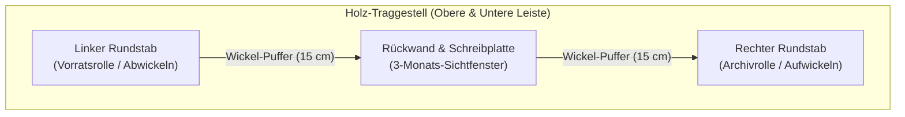

# CronoScroll — Volumen Scroll Calendar 📜

> **Ein interaktiver Generator für endlose Rollkalender mit 3-Monats-Schreibplatte für Großformat-Plotter.**

---

## 💡 Das Konzept

Klassische Kalender blättert man monatsweise um. **CronoScroll** basiert auf dem Prinzip antiker Schriftrollen (*Volumina*):
Der Kalender wird als **ein einziges, zusammenhängendes Banner** (über 2 Meter lang) auf Endlospapier gedruckt und in einen Wand- oder Tischrahmen aus Holz eingespannt.

### Der physische Rahmenaufbau:
* **Zwei horizontale Holzleisten (oben & unten):** Bilden das tragende Gerüst. Sie halten links und rechts die Lagerungen der Rundstäbe und fixieren mittig die Rückwand.
* **Zwei vertikale Rundstäbe (Walzen):** Sind drehbar in der oberen und unteren Holzleiste gelagert und dienen zum Auf- und Abwickeln des Papierbanners.
* **Feste Rückwand / Schreibplatte:** Ist stabil an den beiden horizontalen Holzleisten montiert und bietet eine plane Unterlage zum handschriftlichen Eintragen von Notizen.
* **3-Monats-Sichtfenster:** Die Schreibplatte ist so dimensioniert, dass immer exakt **drei Monate gleichzeitig** im Blickfeld liegen (z. B. Vormonat, aktueller Monat und Folgemonat).
* **14-Monate-Zyklus:** Das Banner umfasst 14 Monate (Dezember des Vorjahres $\to$ alle 12 Monate des Zieljahres $\to$ Januar des Folgejahres). Dadurch rollt man nahtlos über den Jahreswechsel.

---

## 📐 Grafische Darstellung des fertigen Kalenders

### Konstruktions- & Rahmenplan

```text
 ╔══════════════════════════════════════════════════════════════════════════════════════════════════════╗
 ║                         OBERE HORIZONTALE HOLZLEISTE (Tragrahmen)                                    ║
 ║     [ Lager links ] ═══════════════[ Verschraubung Rückwand ]═══════════════ [ Lager rechts ]       ║
 ╚══════════╦══════════════════════════════════════════════════════════════════════════╦════════════════╝
            ║                                                                           ║
      ┌─────╨─────┐                     ┌──────────────────────────────────┐      ┌─────╨─────┐
      │  Linker   │ ◄── Wickel-Puffer ─►│   RÜCKWAND / SCHREIBPLATTE       │◄────►│  Rechter  │
      │  Rundstab │     (z.B. 15 cm)    │   (fest an Querleisten montiert) │      │  Rundstab │
      │           │                     │                                  │      │           │
      │    (O)    │═════════════════════│  ┌────────────────────────────┐  │══════│    (O)    │
      │     ║     │  Papierbahn gleitet │  │  MONAT 1  │ MONAT 2│ MONAT 3│ │  │      │     ║     │
      │     ║     │  über die Platte ─► │  ├───────────┼────────┼────────┤ │  │      │     ║     │
      │     ║     │                     │  │ 01 Sa     │ 01 Di  │ 01 Fr  │ │  │      │     ║     │
      │     ║     │                     │  │ 02 So [WE]│ 02 Mi  │ 02 Sa  │ │  │      │     ║     │
      │     ║     │                     │  │ ...       │ ...    │ ...    │ │  │      │     ║     │
      │     ║     │                     │  │ 31 Mo     │ [Leer] │ 31 So  │ │  │      │     ║     │
      │     ║     │                     │  └────────────────────────────┘  │      │     ║     │
      │    (O)    │                     │                                  │      │    (O)    │
      │           │                     │◄─────── Breite: B_visible ──────►│      │           │
      │(Abwickeln)│                     │          (z.B. 42,0 cm)          │      │(Aufwickeln│
      └─────╥─────┘                     └──────────────────────────────────┘      └─────╥─────┘
            ║                                            ▲                              ║
            ║                                            │ Höhe: H_visible              ║
            ║                                            │ (z.B. 32,0 cm)               ║
            ║                                            ▼                              ║
 ╔══════════╩══════════════════════════════════════════════════════════════════════════╩════════════════╗
 ║     [ Lager links ] ═══════════════[ Verschraubung Rückwand ]═══════════════ [ Lager rechts ]       ║
 ║                         UNTERE HORIZONTALE HOLZLEISTE (Tragrahmen)                                   ║
 ╚══════════════════════════════════════════════════════════════════════════════════════════════════════╝
```

### Explosions- / Baugruppenansicht (Seitenprofil)

```text
       Rückseite (Wand)
             │
             ▼
      ┌─────────────┐  ◄── Obere Querleiste
      │  [Lager] ───┼──────────────┐
      │     │       │              │
      │     ▼       │              │
      │  (Rundstab) │         [Rückwand / Schreibplatte]
      │     │       │              │
      │     ▼       │              │  ◄── Papierbahn läuft auf der Vorderseite
      │  [Lager] ───┼──────────────┘
      └─────────────┘  ◄── Untere Querleiste
             ▲
             │
       Vorderseite
```

### Papierfluss & Funktionsdiagramm



---

## 🧮 Das Mathematische Modell

Alle Abmessungen leiten sich dynamisch von der montierten Schreibplatte ab:

| Parameter                       | Symbol               | Formel / Erklärung                                                           | Standardwert          |
| :------------------------------ | :------------------- | :--------------------------------------------------------------------------- | :-------------------- |
| **Plattenbreite (Sichtbreite)** | $B_{\text{visible}}$ | Lichte Weite der 3 sichtbaren Monate                                         | $42{,}0\text{ cm}$    |
| **Monatsspalten-Breite**        | $B_{\text{month}}$   | $B_{\text{month}} = \frac{B_{\text{visible}}}{3}$                            | $14{,}00\text{ cm}$   |
| **Plattenhöhe (Sichthöhe)**     | $H_{\text{visible}}$ | Papierbahnbreite (Zeilenraum)                                                | $32{,}0\text{ cm}$    |
| **Tageszeilen-Höhe**            | $H_{\text{day}}$     | $H_{\text{day}} = \frac{H_{\text{visible}}}{32}$ *(1 Kopfzeile + 31 Tage)*   | $1{,}00\text{ cm}$    |
| **Wickel-Puffer**               | $\text{Puffer}$      | Freiraum für Befestigung an den Rundstäben                                   | je $15{,}0\text{ cm}$ |
| **Gesamte Bannerlänge**         | $L_{\text{total}}$   | $L_{\text{total}} = (14 \times B_{\text{month}}) + (2 \times \text{Puffer})$ | $226{,}00\text{ cm}$  |

> [!TIP]
> **Optimale Schreibhöhe:** Wenn du als Sichthöhe **$32\text{ cm}$** wählst, ist jede Tageszeile **exakt $1{,}0\text{ cm}$ hoch**. Das bietet optimalen Platz für handschriftliche Termine.

---

## 🚀 Features der Webanwendung (`index.html`)

* **Zwei interaktive Ansichts-Modi:**
  * 🖼️ **3-Monats-Schreibplatte (Fokus-Ansicht):** Zeigt exakt die 3 Monate, wie sie auf der echten Holzplatte liegen. Mit den Buttons `[Zurück]` / `[Vor]` oder den **Pfeiltasten (`←` / `→`)** rollt man nahtlos Monat für Monat durch das Jahr.
  * 📜 **Ganze Druckrolle (14 Monate):** Zeigt das gesamte $2{,}26\text{ m}$ Banner für die Druckkontrolle mit Klick-zu-Monat-Navigation und echtem „Fit All“-Zoom.
* **Interaktive HTML5 Canvas Live-Vorschau:**
  * Reagiert in Echtzeit auf jede Parameteränderung.
  * Stufenloser Zoom von 20 % bis 300 % und 100%-Reset.
* **Typografie & Stil:**
  * Wählbare Schriftarten (*Sans-Serif*, *Serif*, *Monospace*) und skalierbare Schriftgrößen für Kopf- und Tageszeilen.
  * Einstellbare Linienstärken für Gitter und Umrandungen in Millimetern.
  * Farbwähler für Text, Gitterlinien und Wochenenden.
* **Deutsche Feiertage & Schulferien (nach Bundesland):**
  * Automatische Berechnung aller gesetzlichen Feiertage über die Gaußsche Osterformel für alle 16 Bundesländer (**Standard: Nordrhein-Westfalen / NRW**).
  * Berücksichtigt auch die Feiertage der Übergangsmonate (Dezember des Vorjahres und Januar des Folgejahres).
  * Vordefinierte Schulferien (Osterferien, Sommerferien, Herbstferien, Weihnachtsferien) mit einem Klick ladbar.
  * Individuelle Zeiträume (Urlaube, Geburtstage, Meilensteine) frei hinzufügbar und editierbar.
* **Vorlagen-Verwaltung:**
  * Layout-Presets können mit Namen im Browser (`localStorage`) gespeichert, geladen oder gelöscht werden.
* **Vektor-PDF-Export für Endlosplotter auf Deutsch:**
  * Generiert über **jsPDF** eine millimetergenaue Vektor-PDF (`Rollkalender-[Jahr].pdf`) mit deutschen Monatsnamen (`Januar` bis `Dezember`), deutschen Tageskürzeln (`Mo` bis `So`) und Randbeschriftungen.
  * 100 % verlustfrei und gestochen scharf auf jedem Großformat-Plotter druckbar.

---

## 🛠️ Empfehlungen für den Eigenbau

1. **Horizontale Holzleisten (oben & unten):**
   * Querschnitt z. B. $20 \times 40\text{ mm}$ oder $25 \times 50\text{ mm}$ (z. B. Eiche, Buche oder Nussbaum).
   * Erhalten an beiden Enden Sacklöcher bzw. Bohrungen (oder kleine Kugellager/Messingbuchsen) zur Aufnahme der Stabenden.
2. **Vertikale Rundstäbe:**
   * Rundstäbe (Durchmesser $20\text{ bis }25\text{ mm}$). An den Enden ggf. abgedreht oder mit Holzdübeln als Drehachse versehen. Ein oberer Drehknauf oder Rändelrad erleichtert das Weitertransportieren.
3. **Rückwand / Schreibplatte:**
   * Eine $4\text{ bis }6\text{ mm}$ starke Platte (z. B. HDF, Multiplex oder Acrylglas), die oben und unten fest in einer Nut sitzt oder von hinten an die Querleisten verschraubt ist.
   * Die seitlichen Kanten sollten leicht gerundet geschliffen werden, damit das Papier beim Transport nicht kratzt.
4. **Papiersorte:**
   * **$90\text{ bis }120\text{ g/m²}$ gestrichenes CAD-/Plotterpapier (matt)**:
   * Schlägt beim Beschreiben nicht durch.
   * Bleibt auch aufgerollt flexibel und baut nicht zu dick auf den Walzen auf.

---
 
## 💻 Verwendung

Keine Installation und kein Node.js erforderlich. Du kannst die Anwendung lokal durch Öffnen von [index.html](./index.html) in einem modernen Webbrowser (Chrome, Firefox, Safari, Edge) verwenden oder sie über GitHub Pages aufrufen.

Maße deiner Schreibplatte eintragen, Design anpassen und auf **„Plotter-PDF exportieren“** klicken. Die fertige PDF-Datei kannst du an einen Rollenplotter oder Druckdienstleister senden.
