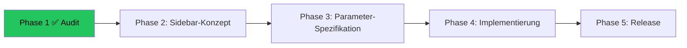

# ChronoScroll – Phase 1: Code-Effizienz & Architektur-Audit

> [!NOTE]
> Read-Only-Analyse. Keine Dateien wurden verändert. Testlauf: **71/71 Tests bestanden** (574 ms).

---

## 1. CODE-EFFIZIENZ & ARCHITEKTUR

### 1.1 Render-Trigger & Debouncing

**Befund: Kein Debouncing / kein `requestAnimationFrame` bei Slider-Inputs.**

In [app.js](file:///Users/lasarkolja/Code/AG-Repos/ChronoScroll/js/app.js#L914-L933) bindet `bindNum()` jedes `<input type="number">` direkt per `input`-Event an `renderPreview()`. Da es sich um `type="number"` (Stepper, kein Range-Slider) handelt, feuert das Event nur bei manueller Eingabe — **nicht bei jedem Pixel-Drag** wie bei `<input type="range">`. Die Auswirkung ist moderat, aber bei schneller Tasteneingabe (z. B. gedrückt halten der Hoch/Runter-Pfeile) werden dennoch ca. 10–15 redundante Neuzeichnungen pro Sekunde ausgelöst.

**Betroffene Inputs (alle rufen `renderPreview()` synchron auf):**
| Gruppe | IDs (Auswahl) |
|---|---|
| Geometrie | `input-h-visible`, `input-b-visible`, `input-puffer-left`, `input-puffer-right` |
| Typografie-Skalierung | `input-font-header-scale`, `input-font-day-scale` |
| Linienbreiten | `input-line-grid`, `input-line-border` |
| Farben | Alle `color-*` Inputs (11 Stück + Kategorie-Farben) |
| Text-Inputs | `input-custom-title`, `input-preset-name` |

**Jede `renderPreview()`-Aufrufkette:**
1. `updateNextYearLink()` → Komprimiert JSON → Base64-URL (relativ teuer)
2. `CronoCanvas.render()` → Geometrie-Berechnung + volles Canvas-Neuzeichnen
3. `publishCadSnapshot()` → JSON-Serialisierung + Listener-Benachrichtigung
4. `updateCoverageStatus()` → Offscreen-Canvas + Pixel-Analyse
5. `invalidateStaleCoverageAdvice()` → JSON-Serialisierung als Cache-Key

> [!IMPORTANT]
> `updateCoverageStatus()` rendert bei jedem Aufruf ein komplettes Offscreen-Banner bei `zoom: 0.25` und analysiert dessen Pixel. Das ist **der mit Abstand teuerste Pfad** und wird derzeit bei *jeder* Farbänderung, *jedem* Titel-Tastendruck usw. ausgelöst.

### 1.2 Duplizierte Geometrielogik (4-fach)

Die Kalenderstruktur (Monatsspalten, Tageszeilen, Hintergrund, Separatoren, Header, KW, Feiertags-Text, Sub-Columns, Schreiblinien, Mondphasen, Crop Marks) ist **in vier unabhängigen Renderern nahezu identisch implementiert**:

| Renderer | Datei | Zeilen (ca.) | Zielformat |
|---|---|---|---|
| **Canvas-Vorschau** | [canvasRenderer.js](file:///Users/lasarkolja/Code/AG-Repos/ChronoScroll/js/canvasRenderer.js#L136-L316) | ~180 | HTML5 Canvas 2D |
| **PDF-Export** | [pdfExport.js](file:///Users/lasarkolja/Code/AG-Repos/ChronoScroll/js/pdfExport.js#L157-L315) | ~160 | jsPDF mm-Koordinaten |
| **SVG-Export** | [svgExport.js](file:///Users/lasarkolja/Code/AG-Repos/ChronoScroll/js/svgExport.js#L50-L176) | ~125 | SVG-Strings in mm |
| **PNG-Export** | [svgExport.js](file:///Users/lasarkolja/Code/AG-Repos/ChronoScroll/js/svgExport.js#L191-L223) | ~30 | Ruft Canvas.render() auf ✅ |

**Risikobereiche bei der Duplizierung:**
- Farbauflösung (flattenColor) wird im PDF-Export explizit angewendet, im SVG-Export fehlt sie bei einigen Hintergründen
- Mondphasen-Rendering und Design-Delegation sind identisch kopiert
- Font-Größen und Text-Offsets sind als magische Zahlen hartcodiert (z. B. `+1.1` SVG vs. `+1.4` PDF vs. `dayHeightPx / 2` Canvas)
- Holiday-Text-Truncation: Canvas nutzt `measureText()` + `while`-Schleife, PDF nutzt `doc.getTextWidth()` + `while`, SVG hat **gar keinen** Kollisionsschutz

### 1.3 Architektur-Stärken

- **`CronoGeometry.calculate()`** ist sauber als reine Funktion implementiert — keine Seiteneffekte, vollständig testbar, single source of truth für alle Maße
- **IIFE-Pattern** mit `window.*`-Namespaces funktioniert zuverlässig für `file://`-Betrieb
- **CAD-Bridge-Pattern** (`CronoScrollCADBridge.subscribe()`) entkoppelt sauber den Kalender- vom CAD-Modus
- **Design-System** (`CronoDesigns`) abstrahiert Design-Varianten über ein Command-Pattern für Canvas, PDF und SVG

---

## 2. RISIKOARME OPTIMIERUNGEN

### Priorität 1 — Hoch (sofort umsetzbar, kein Risiko)

| # | Maßnahme | Aufwand | Auswirkung |
|---|---|---|---|
| **O1** | **`requestAnimationFrame`-Guard für `renderPreview()`**: Eine einzige Wrapper-Funktion, die mehrere synchrone Aufrufe auf den nächsten Frame konsolidiert. Kein einziger Input-Listener muss geändert werden. | ~8 Zeilen in `app.js` | Eliminiert alle redundanten Re-Renders bei schneller Eingabe |
| **O2** | **Coverage-Berechnung entkoppeln**: `updateCoverageStatus()` nur bei explizitem `renderPreview()`-Aufruf und mit Lazy-Delay (z. B. 500 ms `setTimeout` nach letztem Input) statt sofort bei jedem Event. | ~15 Zeilen | Größter Performance-Gewinn |
| **O3** | **`updateNextYearLink()` debounced**: URL-Serialisierung braucht nur bei Idle-State (300 ms), nicht bei jedem Tastendruck. | ~5 Zeilen | Spürbar bei Titel-Eingabe |

### Priorität 2 — Mittel (erfordert sorgfältige Tests)

| # | Maßnahme | Aufwand | Auswirkung |
|---|---|---|---|
| **O4** | **Gemeinsame Month-Iteration abstrahieren**: Ein `iterateMonthLayout(state, geo, monthsData, callbacks)`, das die 4 Renderer mit unterschiedlichen Callbacks bedient. Reduziert Duplizierung von ~465 → ~200 Zeilen. | Mittel | Wartbarkeit, weniger Divergenz-Risiko |
| **O5** | **Text-Offsets als benannte Konstanten**: Magic Numbers (`+1.1`, `+1.4`, `6 * state.zoom`) durch ein Geometrie-Objekt mit `textBaselineOffset`, `paddingLeft` etc. ersetzen. | Klein | Konsistenz zwischen Renderern |

### Priorität 3 — Niedrig (Phase 4+)

| # | Maßnahme | Aufwand | Risiko |
|---|---|---|---|
| **O6** | **SVG-Holiday-Truncation ergänzen**: SVG-Export kürzt Feiertags-Titel aktuell nicht. Bei langen Titeln kann Text über die Zellgrenze ragen. | Klein | Keines — rein additiv |
| **O7** | **Canvas-Invalidation nach Sichtbarkeit**: Wenn Tab nicht aktiv ist (z. B. `document.hidden`), Render-Calls aufschieben. | Klein | Keines |

---

## 3. TEST-STATUS

### 3.1 Aktuelle Abdeckung (71 Tests, 12 Dateien)

```
✅ 71/71 bestanden · 0 fehlgeschlagen · 574 ms
```

| Testdatei | Tests | Abgedeckte Module |
|---|:---:|---|
| [geometry.test.js](file:///Users/lasarkolja/Code/AG-Repos/ChronoScroll/tests/geometry.test.js) | 7 | `CronoGeometry.calculate()`, `flattenColor()`, `createQr()`, Separator-Metriken |
| [canvasRenderer.test.js](file:///Users/lasarkolja/Code/AG-Repos/ChronoScroll/tests/canvasRenderer.test.js) | 10 | Hit-Testing, Double-Column-Rendering, Separatoren, Crop Marks, Ink Coverage, QR-Placement |
| [layoutSettings.test.js](file:///Users/lasarkolja/Code/AG-Repos/ChronoScroll/tests/layoutSettings.test.js) | 1 (groß) | Gesamte UI-Interaktion: Zoom, Tab-Navigation, Presets, Themes, Separators, Kategorie-Farben, URL-State |
| [exportLayouts.test.js](file:///Users/lasarkolja/Code/AG-Repos/ChronoScroll/tests/exportLayouts.test.js) | 7 | PDF/SVG-Geometrie-Konsistenz, Farbkonvertierung, QR in PDF, Design-Theme-Kombinationen |
| [designPresets.test.js](file:///Users/lasarkolja/Code/AG-Repos/ChronoScroll/tests/designPresets.test.js) | 12 | Mondphasen, Design-Varianten, Theme-Palette, Inverse Labels, Schmalformate |
| [coverageAdvisor.test.js](file:///Users/lasarkolja/Code/AG-Repos/ChronoScroll/tests/coverageAdvisor.test.js) | 3 | Empfehlungspriorisierung, Farbaktions-Anwendung |
| [fontManager.test.js](file:///Users/lasarkolja/Code/AG-Repos/ChronoScroll/tests/fontManager.test.js) | 5 | Kern-Table-Erkennung, Font-Validierung, PDF-Embedding |
| [shareConfig.test.js](file:///Users/lasarkolja/Code/AG-Repos/ChronoScroll/tests/shareConfig.test.js) | 7 | URL-Roundtrip, Farbpersistenz, Fehlbehandlung |
| [presetCatalog.test.js](file:///Users/lasarkolja/Code/AG-Repos/ChronoScroll/tests/presetCatalog.test.js) | 3 | Preset-Validierung, Katalog-Generierung |
| [blossomColorPicker.test.js](file:///Users/lasarkolja/Code/AG-Repos/ChronoScroll/tests/blossomColorPicker.test.js) | 7 | Color Picker Adapter, Sync, Lifecycle |
| [cadPdfExport.test.js](file:///Users/lasarkolja/Code/AG-Repos/ChronoScroll/tests/cadPdfExport.test.js) | 2 | CAD-PDF-Export, ViewBox-Restore |
| [uiTheme.test.js](file:///Users/lasarkolja/Code/AG-Repos/ChronoScroll/tests/uiTheme.test.js) | 4 | Dark/Light-Toggle, System-Preference, Local Storage |
| *[realPdfExport.test.js](file:///Users/lasarkolja/Code/AG-Repos/ChronoScroll/tests/realPdfExport.test.js)* | *(benötigt `npm install`)* | *Realer jsPDF-Output* |

### 3.2 Gut abgedeckt ✅

- **Geometrie-Engine**: Alle Berechnungen (single/double layout, Separatoren, QR, Backing Board)
- **State-Management**: Presets laden/speichern, URL-Sharing, Theme-Anwendung
- **Rendering-Konsistenz**: Canvas ↔ PDF ↔ SVG Koordinatenübereinstimmung
- **Hit-Testing**: Klick-zu-Datum-Auflösung in allen Modi
- **Design-System**: Alle 6 Design-Stile × 7 Themes kombinatorisch getestet

### 3.3 Lücken vor dem Umbau ⚠️

| Bereich | Status | Risiko bei Umbau |
|---|---|---|
| **Debouncing / rAF-Guard** | ❌ Nicht testbar (Browser-API) | Gering — reiner Performance-Guard |
| **SVG-Export Text-Truncation** | ❌ Kein Test für fehlenden Kollisionsschutz | Mittel — könnte bei Umbau übersehen werden |
| **iCal-Parser (`icsParser.js`)** | ❌ Keine Tests | Gering — Module nicht vom Umbau betroffen |
| **Mondphasen-Engine (`moon.js`)** | ❌ Keine direkten Unit-Tests (nur indirekt via Design-Tests) | Gering |
| **Puffer-Inhalte (Notes, Year-Overview, Title)** | ❌ Nur implizit via Canvas-Render getestet | Mittel — wenn Sidebar-Umbau Puffer-Optionen ändert |
| **CAD-Modul (`cad-module.js`, 76 KB)** | ❌ Nur Brücken-Snapshot + PDF-Export | Mittel — größte Datei, aber eigener Modus |
| **Preset-Fallbacks für neue Felder** | ❌ Noch keine neuen Felder — Tests müssen mit Phase 3 kommen | Kritisch für Phase 3+4 |

---

## Zusammenfassung & Empfehlung



**Vor Phase 4 empfohlen:**
1. **O1 + O2 umsetzen** (rAF-Guard + Coverage-Lazy) — eliminiert die größten Performance-Probleme ohne Logik-Risiko
2. **Fehlende Tests für SVG-Truncation und Puffer-Inhalte ergänzen** — damit Sidebar-Umbau und neue Parameter regressionsgeschützt sind
3. Die Geometrie-Abstraktion (O4) erst in Phase 4 angreifen, da sie die Renderer berührt

